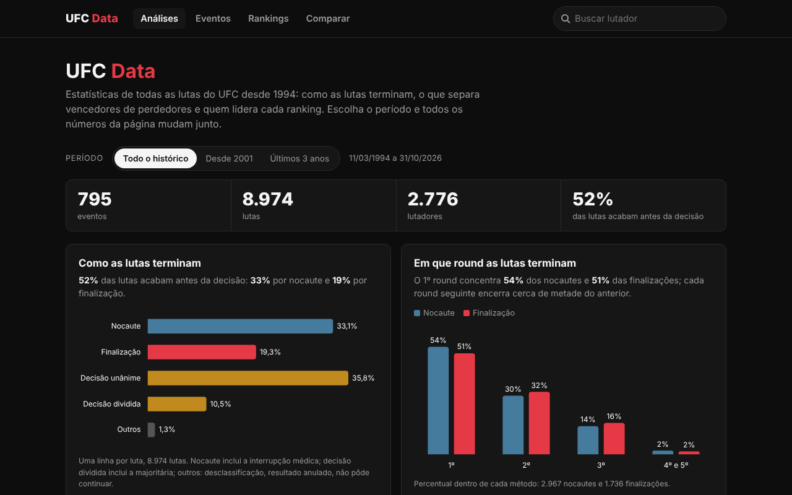
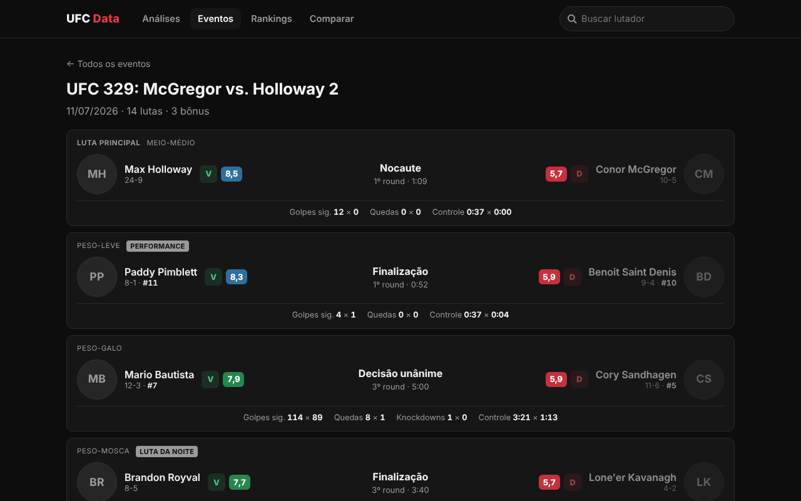
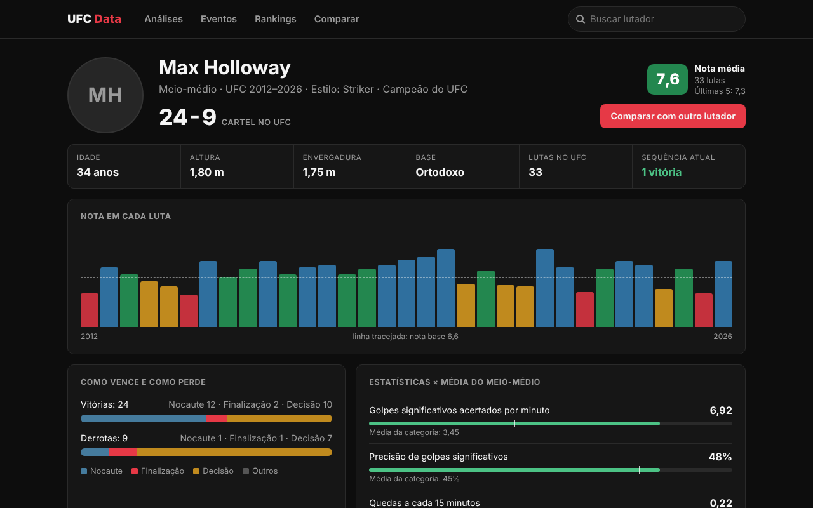
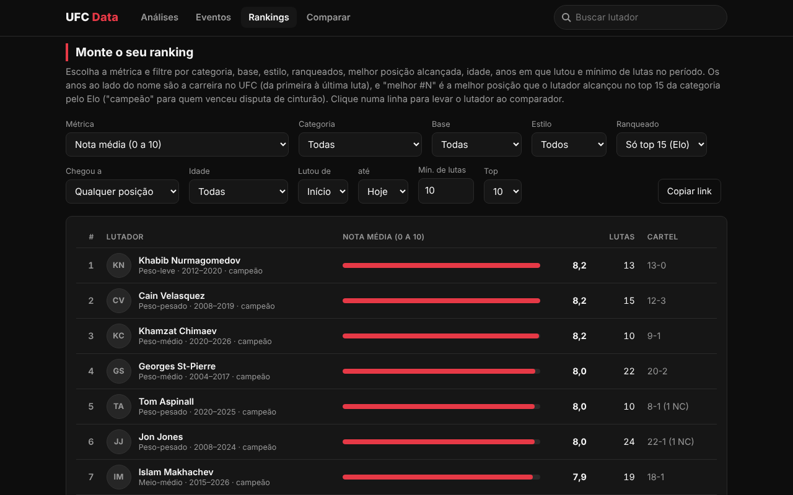

# UFC Data: 32 anos de lutas do UFC em números

[](https://github.com/khannnn1/ufc-data/actions/workflows/testes.yml)

🔗 **[Abrir o site](https://khannnn1.github.io/ufc-data/)** · [Eventos](https://khannnn1.github.io/ufc-data/eventos.html) · [Rankings e comparador](https://khannnn1.github.io/ufc-data/interativo.html) · [Gráficos](https://khannnn1.github.io/ufc-data/graficos.html) · [Metodologia](https://khannnn1.github.io/ufc-data/sobre.html)

Projeto de ponta a ponta com o histórico completo do UFC: **795 eventos** (do UFC 2, em 1994, a outubro de 2026), **8.974 lutas** e **2.776 lutadores**. Os dados são coletados por web scraping, limpos e analisados em **Python** e **SQL**, viram gráficos em estilo editorial (inspirado em contas como @DataFut), um modelo estrela para **Power BI** e um **site** em JavaScript no formato de um app de resultados esportivos, com uma **nota de 0 a 10 para cada lutador em cada luta**.



## Que perguntas o projeto responde

| Parte | Pergunta | Onde |
|---|---|---|
| **Análises** | Como as lutas terminam, em que round, em que categoria, e o que separa quem vence de quem perde? Tudo muda junto com o período escolhido (histórico todo, desde 2001, últimos 3 anos). | [`index.html`](https://khannnn1.github.io/ufc-data/) |
| **Eventos** | O que aconteceu em cada card, luta a luta: método, round, bônus, cinturão, golpes, quedas e a nota de cada lado. | [`eventos.html`](https://khannnn1.github.io/ufc-data/eventos.html) |
| **Perfil** | Como um lutador vence e como perde, como se compara à média da categoria e como foi a nota em cada luta da carreira. | [`lutador.html`](https://khannnn1.github.io/ufc-data/lutador.html?n=Max+Holloway) |
| **Rankings** | Quem lidera cada métrica (nota média, nocautes, precisão, controle...) com filtros de categoria, base, estilo, idade, anos de carreira, posição alcançada e amostra mínima. | [`interativo.html#ranking`](https://khannnn1.github.io/ufc-data/interativo.html#ranking) |
| **Comparador** | Dois lutadores lado a lado: médias, rendimento round a round, e o que a história diz das vantagens de cada um (idade, envergadura, base). | [`interativo.html#comparador`](https://khannnn1.github.io/ufc-data/interativo.html?a=Alex+Pereira&b=Jon+Jones#comparador) |
| **Gráficos** | 22 gráficos estáticos (Matplotlib) com a leitura de cada um. | [`graficos.html`](https://khannnn1.github.io/ufc-data/graficos.html) |
| **SQL e Power BI** | As mesmas perguntas em SQL, conferidas com o Pandas, e um painel no Power BI. | [`notebooks/03_sql.ipynb`](notebooks/03_sql.ipynb) · [`powerbi/`](powerbi/README.md) |

<table>
<tr>
<td width="50%"><br><sub>Card do evento: vencedor à esquerda, nota de cada lado, posição no top 15 e bônus.</sub></td>
<td width="50%"><br><sub>Perfil: nota em cada luta, como vence e como perde, estatísticas contra a média da categoria.</sub></td>
</tr>
<tr>
<td colspan="2"><br><sub>Monte o seu ranking: todos os filtros ficam no endereço da página, então qualquer ranking vira um link.</sub></td>
</tr>
</table>

<sub>As fotos dos lutadores vêm do ufc.com e aparecem no site publicado; nas capturas acima ficaram as iniciais.</sub>

## Destaques da análise

- **Metade das lutas termina antes da decisão dos juízes:** 33% por nocaute e 19% por finalização, e mais da metade delas no 1º round.
- **Knockdown é o que mais separa vencedores de perdedores:** quem vence derruba o adversário cerca de 6× mais. Nos golpes significativos a diferença é bem menor (1,5×).
- **A luta se decide no chão:** vencedores acertam 18% dos golpes no chão, contra 6% dos perdedores.
- **Idade pesa mais que envergadura:** o lutador mais novo vence 57% das lutas (67% quando a diferença passa de 8 anos); quem tem mais envergadura vence só 52%.
- **A vantagem do canhoto é pequena, mas real:** contra ortodoxos, o canhoto vence 53% de 2.470 lutas (intervalo de 95%: 51% a 55%). No recorte de 2023 a 2026 o mesmo 53% cabia no acaso: foi preciso o histórico completo para sustentar a conclusão.
- **Disputas de cinturão duram mais e levam mais bônus:** 15,4 minutos em média contra 10,3, e 17% levam Luta da Noite, contra 6% (438 disputas, sem as finais do TUF).
- **A Luta da Noite premia a troca, não a finalização rápida:** ritmo 1,4× maior, o perdedor também derruba o adversário em 17% delas (5% nas demais), e 58% vão para a decisão.
- **Quanto mais pesada a divisão, mais lutas acabam antes da decisão:** peso-pesado 66%, palha feminino 34%.

## A nota de cada luta (0 a 10)

Inspirada nas notas de apps de resultados de futebol, mas montada com o que os dados de MMA permitem medir (`src/rating.py`). Cada lutador em cada luta recebe:

**nota = 6,6 + resultado + desempenho + adversário**, limitada entre 3 e 10.

- **Resultado:** vencer soma e perder tira; nocaute e finalização valem mais quanto mais cedo acontecem, decisão dividida vale menos que unânime.
- **Desempenho:** uma regressão logística (escrita em NumPy) treinada nas lutas decididas pelos juízes diz quanto cada estatística por minuto pesa para vencer: golpes na cabeça, no corpo e na perna, knockdowns, quedas, controle, tentativas de finalização, reversões, e quedas erradas com peso negativo. As colunas são padronizadas antes da regularização; sem isso, o knockdown, raro, era encolhido até valer o mesmo que um golpe e meio. O estilo do lutador (striker, wrestler, finalizador ou completo, classificado só com as lutas anteriores) ajusta os pesos do ataque.
- **Adversário:** vencer quem tem Elo alto vale mais. O Elo é calculado do zero para todo o histórico e também gera o **top 15 de cada categoria na véspera de cada luta**.

Calibração no histórico completo: média 6,70; vencedor 7,61 e perdedor 5,79; em 2% das lutas o perdedor recebe nota maior que o vencedor; nas decisões, a parte de desempenho aponta o mesmo vencedor que os juízes em 85% das vezes. A explicação para o público está em [sobre.html#nota](https://khannnn1.github.io/ufc-data/sobre.html#nota).

## Pipeline

```
ufcstats.com                         ufc.com
   │  scraper.py (Selenium + BS4)       │  fotos.py (requests, respeita o robots.txt)
   │  atualizar.py: só o que falta      │
   ▼                                    ▼
data/raw/*.csv  ──── limpeza.py ────►  data/processed/*.csv
                                          │
   ├──► rating.py (nota de cada luta, estilo, Elo, top 15)
   ├──► notebooks (Matplotlib) ──► figures/*.png ──► graficos.html
   ├──► exportar.py + analises.py ──► dados/*.json ──► site (Chart.js)
   ├──► banco.py ──► data/ufc.db (SQLite) ──► sql/consultas.sql ──► 03_sql.ipynb
   └──► powerbi.py ──► powerbi/dados/*.csv (modelo estrela) ──► Power BI
```

1. **Coleta** (`src/scraper.py`, `src/atualizar.py`): o ufcstats.com responde com uma verificação anti-bot que exige JavaScript, então a coleta usa Selenium em modo headless. As tabelas trazem os dois lutadores na mesma célula e o `pandas.read_html` não separa isso: o parsing é manual com BeautifulSoup. Três tipos de página: luta (estatísticas no total e por round), evento (categoria, cinturão, bônus, link de cada lutador) e lutador (altura, envergadura, base, nascimento). A coleta salva cada evento assim que termina e pode ser interrompida e retomada; o histórico completo levou 4h41. Uma execução sem eventos novos leva ~15 s.
2. **Limpeza** (`src/limpeza.py`): `"181 of 305"` vira acertados/tentados, percentuais e tempos `M:SS` viram números, `5' 11"` vira centímetros, `"---"` (nenhuma tentativa) vira ausente e não 0%. A duração de cada luta sai do formato de tempo da época (lutas antigas tinham rounds de 10+ minutos ou nenhum limite).
3. **Gráficos** (`notebooks/02_visualizacao.ipynb`, `src/visualizacao.py`): padrão visual único, com fundo escuro, barras com o valor na ponta e cores validadas para daltonismo.
4. **Site** (`src/exportar.py`, `src/analises.py`, `js/`): JSONs compactos por período (totais por lutador, todas as lutas, análises da página inicial). Médias, filtros e rankings são calculados no navegador; não há servidor, o site é estático no GitHub Pages.
5. **SQL** (`src/banco.py`, `sql/`): banco SQLite com 6 tabelas relacionadas (`eventos` → `lutas` → `desempenho` → `desempenho_round`, mais `lutadores` e `notas`), com chaves primárias e estrangeiras. 19 consultas nomeadas com JOINs (inclusive *self-join* vencedor × perdedor), `GROUP BY`/`HAVING`, CTEs, funções de janela (`RANK`, `ROW_NUMBER`, `SUM() OVER`), datas com `julianday()` e *gaps and islands* para sequências de vitórias. O notebook **confere cada resposta com o resultado em Pandas**.
6. **Power BI** (`src/powerbi.py`, `powerbi/`): modelo estrela (fato de desempenho, fato por round, dimensões de luta, lutador e calendário) em CSV no formato pt-BR, medidas DAX com as mesmas regras dos gráficos e um tema com as cores do projeto.
7. **Testes** (`tests/`, `pytest`): 80 testes em ~3 s, sem internet e sem os dados coletados, com páginas HTML mínimas no formato do ufcstats e um mini-dataset sintético de 3 lutas. Cobrem limpeza, parsing, agregação, rating, a atualização com um navegador falso e todas as consultas SQL contra o `schema.sql` real. Rodam no GitHub Actions a cada push.

## Desafios e aprendizados

- **O site de origem não queria ser lido.** O `requests` recebia só a página anti-bot. Selenium resolveu, mas com uma pausa fixa de 5 s por página o histórico levaria dias; esperando o conteúdo aparecer (só o 1º acesso passa pela verificação), cada página carrega em menos de 1 s.
- **Dados antigos têm outras regras.** Lutas dos anos 1990 não tinham limite de tempo, tinham rounds de 15 minutos ou nenhuma estatística. Médias sem recorte distorciam tudo, daí o filtro de período em todo o site e as médias calculadas só sobre as lutas que têm estatísticas.
- **Contar errado é fácil.** O dataset tem uma linha por lutador em cada luta; o primeiro gráfico de métodos de vitória contava cada luta duas vezes. Desde então, toda pergunta sobre lutas usa uma linha por luta, e os testes e o notebook SQL conferem os números por dois caminhos.
- **Significância muda conclusões.** A "vantagem do canhoto" no recorte de 3 anos cabia no acaso; só com o histórico inteiro o intervalo de confiança ficou acima de 50%.
- **Um modelo precisa ser criticado.** A primeira versão da nota dava ao knockdown o peso de 1,5 golpe por causa da regularização sem padronizar as colunas; depois de uma revisão crítica, a calibração passou a ser medida (concordância com os juízes, perdedor acima do vencedor, distribuição das notas) antes de cada mudança.
- **Detalhes da fonte enganam.** Finais do TUF vêm marcadas como disputa de cinturão, nomes iguais escondem pessoas diferentes ("Bruno Silva" do peso-médio e do peso-mosca), e o UFC 1 nem aparece na listagem. Cada caso virou regra no código e teste.

## Decisões de análise

Alguns cuidados que mudam o resultado e que estão aplicados nos gráficos:

- **Médias por luta, não somas**, ao comparar lutadores com números de lutas diferentes.
- **Amostra mínima em todo ranking de taxa ou precisão** (ex.: taxa de vitória só com 6+ lutas; precisão de quedas com 15+ tentativas e 3+ lutas). Sem isso, o topo vira quem tentou pouco e acertou tudo.
- **Uma linha por luta** quando a pergunta é sobre lutas. O dataset tem uma linha por lutador em cada luta, e contar direto dobraria tudo (um erro que o projeto teve e corrigiu).
- **Volume por minuto, não por luta**, para não penalizar quem finaliza cedo.
- **Associação não é causa**, e isso aparece nas legendas: um knockdown muitas vezes já é o começo do fim da luta; a taxa de finalização de um árbitro reflete as lutas que ele recebe, não o estilo dele.
- **Intervalo de confiança quando a diferença é pequena**: no confronto de bases, 53% contra 50% parecia vantagem, mas no recorte de 2023 a 2026 o intervalo de 95% mostrava que a amostra não sustentava a conclusão. Com o histórico completo, o mesmo 53% passa a ter intervalo acima de 50%.
- **Viés de sobrevivência**: rounds avançados só existem em lutas longas, então médias por round não comparam as mesmas lutas.
- **Nome não é identificador**: existem dois "Bruno Silva" diferentes na base (um peso-médio e um peso-mosca). O link da página de cada lutador é a chave; quando dois nomes coincidem, o nome exibido ganha o ano de nascimento, "Bruno Silva (1989)" e "Bruno Silva (1990)", para as estatísticas não se misturarem.
- **Final do TUF não é disputa de cinturão**: o ufcstats marca as finais do reality show com o mesmo ícone das disputas de título. Pelo formato (3 rounds, a partir de 2005) o projeto separa as 65 finais, e as análises contam 438 disputas de verdade, não 503.
- **"Top 15" é uma reconstrução, não o ranking oficial**: o ranking oficial do UFC só existe desde 2013 e não tem histórico público, então a posição de cada lutador na véspera de cada luta vem do Elo calculado pelo próprio projeto (os 15 maiores da categoria, entre quem lutou nos últimos 2 anos e tem 3+ lutas).
- **Desempate estável nos rankings**: com 15 lutadores empatados em 7 vitórias disputando 8 vagas, quem aparecia no top 10 mudava a cada atualização. Nos totais, em empate vem antes quem precisou de menos lutas; em médias e taxas, quem tem mais lutas (amostra maior); por último, a ordem alfabética.

## Stack

**Python** (Pandas, NumPy, Matplotlib, Selenium, BeautifulSoup, Jupyter, pytest) · **SQL** (SQLite) · **Power BI** (DAX) · **JavaScript** (Chart.js) · **HTML/CSS** · **Git** (Git Flow) · **GitHub Actions** · **GitHub Pages**

## Estrutura do projeto

```
├── data/                  # CSVs brutos e limpos, banco SQLite (não versionados)
├── dados/                 # JSONs que o site lê (lutadores por período, lutas, análises)
├── figures/               # gráficos exportados (.png)
├── notebooks/
│   ├── 01_scrapper_test_luta.ipynb   # coleta e limpeza
│   ├── 02_visualizacao.ipynb         # análise e gráficos
│   └── 03_sql.ipynb                  # as mesmas perguntas em SQL
├── sql/                   # schema.sql (6 tabelas) e consultas.sql
├── src/
│   ├── scraper.py         # coleta (Selenium + BeautifulSoup)
│   ├── atualizar.py       # busca o que falta e regenera tudo
│   ├── limpeza.py         # tratamento dos dados
│   ├── rating.py          # nota 0–10, estilo, Elo e top 15
│   ├── exportar.py        # JSONs do site
│   ├── analises.py        # números da página inicial
│   ├── visualizacao.py    # padrão visual dos gráficos
│   ├── banco.py           # monta o banco SQLite
│   ├── consultas.py       # executa as consultas de sql/consultas.sql
│   ├── powerbi.py         # modelo estrela para o Power BI
│   └── fotos.py           # foto de cada lutador no ufc.com
├── powerbi/               # CSVs do modelo, medidas DAX, tema e roteiro do painel
├── tests/                 # pytest
├── css/, js/              # estilo e lógica do site
├── index.html             # análises (página inicial)
├── eventos.html           # eventos e card de cada evento
├── lutador.html           # perfil do lutador
├── interativo.html        # rankings e comparador
├── graficos.html          # gráficos em PNG
└── sobre.html             # fontes e metodologia
```

## Como rodar

```bash
python -m venv venv
venv\Scripts\Activate.ps1          # Windows (Linux/macOS: source venv/bin/activate)
pip install -r requirements.txt
```

- **Coleta e limpeza:** `notebooks/01_scrapper_test_luta.ipynb` (precisa do Google Chrome instalado para o Selenium).
- **Atualizar com eventos novos:** `python -m src.atualizar` busca só os eventos mais recentes que o último da base (e as páginas de evento e de lutador que faltarem), limpa os dados e regenera o JSON do site e o banco SQL; com `--graficos`, também reexecuta os notebooks de gráficos e SQL.
- **Publicar sozinho depois de cada evento:** `python -m src.publicar` coleta os eventos já encerrados, regenera tudo, confere os números, roda os testes e publica só os arquivos do site na `main`. O `scripts/agendar_publicacao.ps1` agenda isso no Agendador de Tarefas do Windows (todo dia ao meio-dia, numa cópia de trabalho própria); as instruções estão no topo do script.
- **Coletar o histórico completo:** `python -m src.atualizar --historico` coleta todos os eventos que faltam, até os primeiros UFCs dos anos 1990. Leva algumas horas; pode ser interrompido com Ctrl+C e retomado rodando o mesmo comando. Para testar antes, `--limite 5` coleta só 5 eventos.
- **Gráficos:** `notebooks/02_visualizacao.ipynb`.
- **SQL:** `notebooks/03_sql.ipynb` recria o banco (`data/ufc.db`) e roda as consultas. Para só gerar o banco: `python -m src.banco`.
- **Dados do site:** `python -m src.exportar` (na raiz do projeto) regenera os JSONs de `dados/`.
- **Power BI:** `python -m src.powerbi` regenera `powerbi/dados/` (o `src.atualizar` já faz isso); o roteiro está em `powerbi/README.md`.
- **Testes:** `python -m pytest` (na raiz do projeto). O GitHub Actions roda os mesmos testes a cada push em `main` e `develop` (`.github/workflows/testes.yml`), instalando só o `requirements-test.txt`.
- **Ver o site localmente:** `python -m http.server` e abrir `http://localhost:8000`. Abrir o HTML direto do disco não funciona, porque o navegador bloqueia a leitura do JSON.
